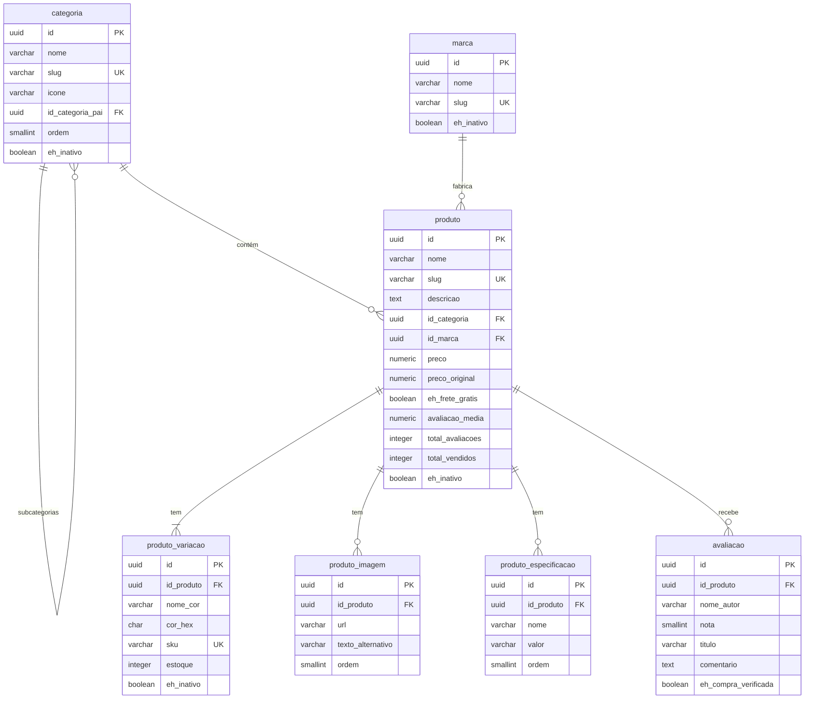

# Modelo de dados

Modelo do MVP (catálogo, produto e carrinho). O carrinho fica no navegador e não tem tabela. Base: [histórias de usuário](historias-de-usuario.md).

## 1. Substantivos das telas

| Coisa | O que a tela mostra sobre ela | Onde aparece |
|---|---|---|
| Categoria | nome, ícone, subcategorias, total de produtos | menu, home, filtro, breadcrumb |
| Marca | nome, total de produtos | filtro, página do produto |
| Produto | nome, descrição, preço, preço original, desconto, parcelamento, valor no Pix, frete grátis, avaliação média, total de avaliações, "mais de 5 mil vendidos" | card, página do produto, carrinho |
| Variação | cor (nome e amostra), estoque ("12 disponíveis") | página do produto, carrinho |
| Imagem | foto, ordem na galeria (1 / 5) | card, galeria |
| Especificação | nome e valor (Bateria: Até 40 h) | página do produto |
| Avaliação | autor, data, nota, título, texto, compra verificada | página do produto |

Calculados na tela, sem coluna: desconto (%), parcela (preço / 10), valor no Pix (preço × 0,95), distribuição de estrelas.

## 2. Entidades

Todas as tabelas ficam no schema `public`, usam `uuid` como chave primária e têm as colunas de auditoria `criado_em` e `atualizado_em`.

### categoria

Agrupa produtos. Pode ter uma categoria pai (Áudio > Fones de ouvido).

| Coluna | Tipo | Obrigatório | Regra |
|---|---|---|---|
| id | uuid | sim | chave primária |
| nome | varchar(80) | sim | |
| slug | varchar(80) | sim | único; usado na URL |
| icone | varchar(40) | não | nome do ícone |
| id_categoria_pai | uuid | não | FK `categoria.id`; nulo = categoria principal |
| ordem | smallint | sim | padrão `0`; ordem de exibição no menu |
| eh_inativo | boolean | sim | padrão `false` |
| criado_em | timestamptz | sim | preenchido na inclusão |
| atualizado_em | timestamptz | sim | atualizado a cada alteração |

### marca

| Coluna | Tipo | Obrigatório | Regra |
|---|---|---|---|
| id | uuid | sim | chave primária |
| nome | varchar(80) | sim | |
| slug | varchar(80) | sim | único |
| eh_inativo | boolean | sim | padrão `false` |
| criado_em | timestamptz | sim | preenchido na inclusão |
| atualizado_em | timestamptz | sim | atualizado a cada alteração |

### produto

| Coluna | Tipo | Obrigatório | Regra |
|---|---|---|---|
| id | uuid | sim | chave primária |
| nome | varchar(150) | sim | |
| slug | varchar(160) | sim | único |
| descricao | text | sim | |
| id_categoria | uuid | sim | FK `categoria.id`; sempre a categoria mais específica (Fones de ouvido, não Áudio) |
| id_marca | uuid | sim | FK `marca.id` |
| preco | numeric(10,2) | sim | `> 0`; preço cobrado |
| preco_original | numeric(10,2) | não | `> preco`; nulo = sem desconto |
| eh_frete_gratis | boolean | sim | padrão `false` |
| avaliacao_media | numeric(2,1) | sim | padrão `0`; entre 0 e 5 |
| total_avaliacoes | integer | sim | padrão `0`; `>= 0` |
| total_vendidos | integer | sim | padrão `0`; `>= 0` |
| eh_inativo | boolean | sim | padrão `false` |
| criado_em | timestamptz | sim | preenchido na inclusão |
| atualizado_em | timestamptz | sim | atualizado a cada alteração |

### produto_variacao

Cada cor de um produto. Todo produto tem ao menos uma variação.

| Coluna | Tipo | Obrigatório | Regra |
|---|---|---|---|
| id | uuid | sim | chave primária |
| id_produto | uuid | sim | FK `produto.id` |
| nome_cor | varchar(40) | sim | único por produto |
| cor_hex | char(7) | sim | formato `#RRGGBB` |
| sku | varchar(40) | sim | único global |
| estoque | integer | sim | `>= 0` |
| eh_inativo | boolean | sim | padrão `false` |
| criado_em | timestamptz | sim | preenchido na inclusão |
| atualizado_em | timestamptz | sim | atualizado a cada alteração |

### produto_imagem

| Coluna | Tipo | Obrigatório | Regra |
|---|---|---|---|
| id | uuid | sim | chave primária |
| id_produto | uuid | sim | FK `produto.id` |
| url | varchar(500) | sim | |
| texto_alternativo | varchar(200) | sim | acessibilidade |
| ordem | smallint | sim | única por produto; ordem `0` é a capa |
| criado_em | timestamptz | sim | preenchido na inclusão |
| atualizado_em | timestamptz | sim | atualizado a cada alteração |

### produto_especificacao

| Coluna | Tipo | Obrigatório | Regra |
|---|---|---|---|
| id | uuid | sim | chave primária |
| id_produto | uuid | sim | FK `produto.id` |
| nome | varchar(60) | sim | único por produto |
| valor | varchar(200) | sim | |
| ordem | smallint | sim | |
| criado_em | timestamptz | sim | preenchido na inclusão |
| atualizado_em | timestamptz | sim | atualizado a cada alteração |

### avaliacao

| Coluna | Tipo | Obrigatório | Regra |
|---|---|---|---|
| id | uuid | sim | chave primária |
| id_produto | uuid | sim | FK `produto.id` |
| nome_autor | varchar(80) | sim | |
| nota | smallint | sim | entre 1 e 5 |
| titulo | varchar(120) | sim | |
| comentario | text | não | |
| eh_compra_verificada | boolean | sim | padrão `false` |
| criado_em | timestamptz | sim | preenchido na inclusão |
| atualizado_em | timestamptz | sim | atualizado a cada alteração |

## 3. Relacionamentos

| De | Para | Cardinalidade | Leitura |
|---|---|---|---|
| categoria | categoria | 1:N | uma categoria tem várias subcategorias |
| categoria | produto | 1:N | uma categoria tem vários produtos; um produto tem uma categoria |
| marca | produto | 1:N | uma marca tem vários produtos; um produto tem uma marca |
| produto | produto_variacao | 1:N | um produto tem uma ou mais cores |
| produto | produto_imagem | 1:N | um produto tem várias imagens |
| produto | produto_especificacao | 1:N | um produto tem várias especificações |
| produto | avaliacao | 1:N | um produto tem várias avaliações |

## 4. Diagrama ER

## 5. Decisões

| Pergunta | Opções | Decisão | Motivo |
|---|---|---|---|
| Como guardar dinheiro? | `float`, `numeric(10,2)` | `numeric(10,2)` / `BigDecimal` | `float` erra centavos (0,1 + 0,2 ≠ 0,3) |
| Guardar o percentual de desconto? | guardar, calcular | calcular | sai de `preco` e `preco_original`; guardar permitiria valores contraditórios |
| Média e total de avaliações | guardar no produto, calcular na consulta | guardar no produto | a listagem filtra e ordena por nota; calcular a cada consulta exigiria agrupar todas as avaliações. Custo: atualizar ao inserir avaliação |
| Preço por produto ou por variação? | produto, variação | produto | nos mockups todas as cores custam o mesmo. Mudar depois = mover a coluna |
| Estoque por produto ou por variação? | produto, variação | variação | mockup e painel admin mostram estoque por cor |
| Subcategoria: tabela própria ou auto-relacionamento? | tabela, `id_categoria_pai` | auto-relacionamento | mesma estrutura; permite mais níveis sem nova tabela |
| Produto em mais de uma categoria? | 1:N, N:N | 1:N | mais simples; os filtros só precisam de uma |
| "Ofertas do dia" e "Mais vendidos" precisam de tabela? | tabela, consulta | consulta | ofertas = maior desconto; mais vendidos = `total_vendidos`. Tabela só quando houver curadoria manual |
| Parcelamento e Pix no banco? | colunas, regra no código | regra no código | são regras da loja (10x, 5%), iguais para todos os produtos |
| Busca sem acento | `LIKE`, `unaccent` + `pg_trgm` | `unaccent` + `pg_trgm` | "audio" precisa achar "Áudio"; trigrama deixa a busca parcial rápida |
| Soft delete | apagar, `eh_inativo` | `eh_inativo` | produto removido não pode sumir de pedidos futuros |

## 6. Índices

Chaves primárias e colunas `UNIQUE` já ganham índice automaticamente.

| Tabela | Colunas | Por quê |
|---|---|---|
| produto | `id_categoria` | listar produtos de uma categoria |
| produto | `id_marca` | filtro por marca |
| produto | `preco` | filtro por faixa de preço e ordenação |
| produto | `avaliacao_media` | filtro "4 estrelas ou mais" e ordenação |
| produto | `total_vendidos` | "Mais vendidos" |
| produto | `unaccent(lower(nome))` com `gin_trgm_ops` | busca por nome |
| categoria | `id_categoria_pai` | montar o menu e buscar subcategorias |
| produto_variacao | `id_produto` | carregar as cores do produto |
| produto_imagem | `(id_produto, ordem)` único | galeria em ordem |
| produto_especificacao | `id_produto` | página do produto |
| avaliacao | `(id_produto, criado_em desc)` | avaliações mais recentes primeiro |
